  

## Features

- **Beautiful**: cards, minimal or chat-bubble styles, light/dark/auto theme, your accent colour and custom CSS.
- **Animated**: smooth entrances, popping likes, rolling counters, toasts. Respects reduced-motion settings.
- **Likes & dislikes**: instant voting, "Top" sorting, low-score comments fold away.
- **Threaded replies**: pinning, collapsible threads, Author and Administrator badges.
- **Live Markdown editor**: formatting shows as you type, lists continue on Enter, toolbar and preview.
- **Moderation**: approve, spam, pin, edit and delete right on the page, plus an admin dashboard.
- **Secure**: no raw HTML, CSRF protection, honeypot, captcha, flood limits, word and domain filters.
- **SEO friendly**: server-rendered, schema.org markup, `rel="ugc nofollow"` links.
- **English & Arabic**, with full right-to-left support.

## Permissions

Every action is a permission in **Options → Permissions**, per user group:

Write comments · Reply · Auto publish comment · Like & dislike · Use Markdown · Post links · Embed images · Post code · Edit / delete own comments · Moderate · Bypass limits

Guests can comment with just a name out of the box. Their comments wait for approval unless you allow **Auto publish comment** for the Guest group.

## Requirements

Joomla 5 or later, PHP 8.1+.

## License

GNU GPL v2 or later.
